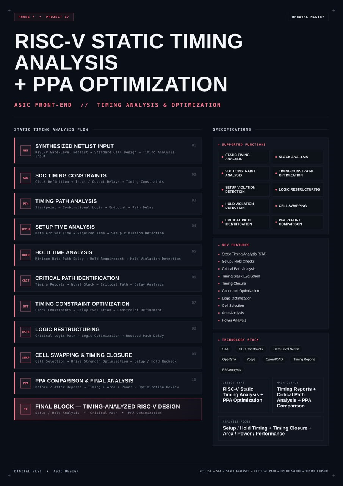
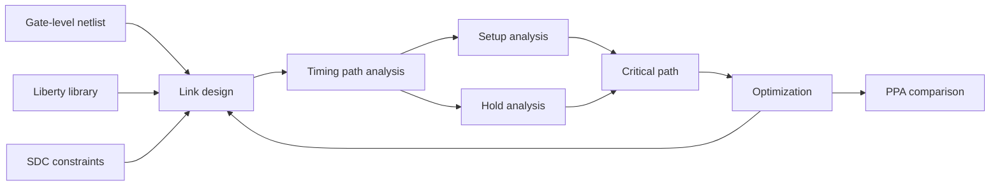
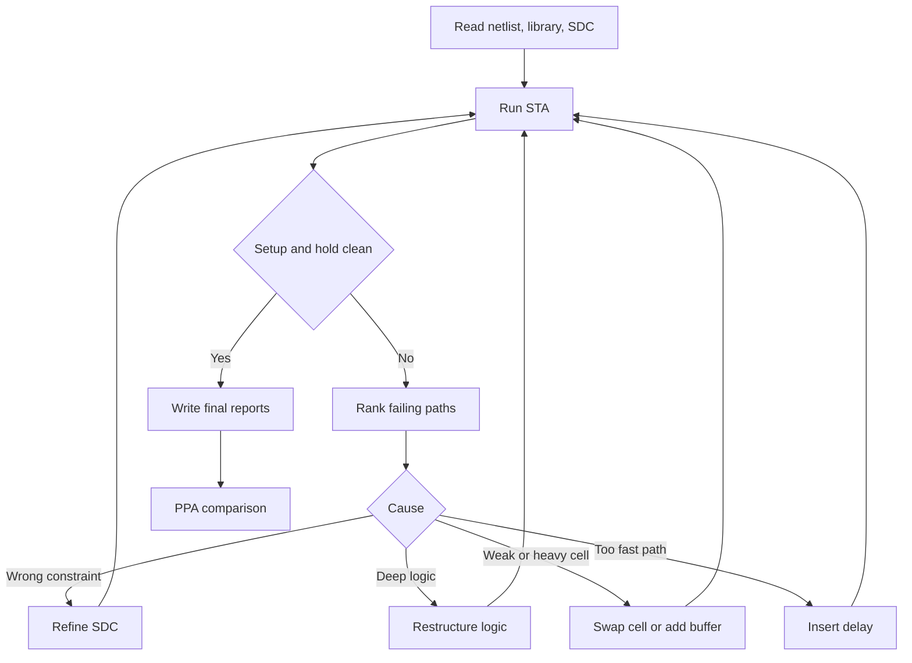
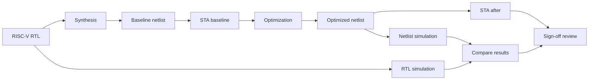
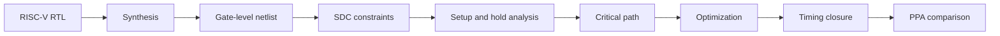

<div align="center">




<b>A static timing analysis and PPA optimization flow for a synthesized RISC-V gate-level netlist: SDC constraints, setup and hold checks, critical path identification, logic restructuring, cell swapping and a before and after comparison of timing, area and power.</b>

<br/>


<br/>

[Overview](#overview) |
[At a Glance](#project-at-a-glance) |
[Background](#background-why-static-timing-analysis) |
[Functions](#supported-functions) |
[Architecture](#architecture) |
[Functional Description](#functional-description) |
[SDC Constraints](#sdc-timing-constraints) |
[Setup and Hold](#setup-and-hold-analysis) |
[Optimization](#optimization-techniques) |
[Closure Loop](#timing-closure-loop) |
[Interface](#interface-and-inputs) |
[Getting Started](#getting-started) |
[Verification](#verification-and-sign-off) |
[PPA](#ppa-comparison) |
[Troubleshooting](#troubleshooting) |
[FAQ](#faq) |
[License](#license)

</div>

---

## Overview

This project performs **static timing analysis (STA)** and **PPA optimization** on a **synthesized RISC-V design**. It starts from a **gate-level netlist** built from **standard cells**, applies **SDC timing constraints**, and checks every timing path in the design without running a single simulation vector. It then uses what the analysis reports to improve the design, and compares the design before and after optimization in terms of **timing, area and power**.

The flow follows the order in which a timing engineer works. The **synthesized netlist** and the **cell library** are read. The **SDC constraints** define the clock, the input and output delays, the uncertainty and the exceptions. **Timing path analysis** breaks the design into startpoint to endpoint paths. **Setup time analysis** checks that data arrives before the capturing clock edge, and **hold time analysis** checks that data does not change too soon after it. The **critical path** is identified from the worst slack. **Constraint optimization**, **logic restructuring** and **cell swapping** then reduce path delay and repair violations, and the design is rechecked until **timing closure** is reached. A final **PPA comparison** puts the before and after reports side by side.

The design under analysis is a **RISC-V RV32I processor core**. A processor is a good subject for timing work: it has a long datapath (register read, ALU, memory access, write-back), a control path with many small decisions, feedback through the program counter, and a clear target clock frequency to chase. Every number in this document that depends on a run is marked **TBD**, because the reports must come from your own netlist, library and constraints.

<table>
<tr>
<td width="50%" valign="top">

#### Objectives
- Read a synthesized RISC-V netlist and a standard cell library into an STA tool
- Write SDC constraints that describe the clock and the interface timing
- Analyze setup and hold timing on every path
- Identify the critical path and its worst slack
- Apply constraint, logic and cell level optimization to remove violations
- Re-run the analysis until setup and hold both meet their requirements
- Compare timing, area and power before and after optimization

</td>
<td width="50%" valign="top">

#### Key Features
- Static timing analysis (STA)
- Setup and hold checks
- Critical path analysis
- Timing slack evaluation
- Timing closure
- Constraint optimization
- Logic optimization
- Cell selection
- Area analysis
- Power analysis

</td>
</tr>
</table>

---

## Project at a Glance

| Attribute | Detail |
|:--|:--|
| **Design type** | RISC-V static timing analysis and PPA optimization |
| **Design under analysis** | RISC-V RV32I processor, synthesized gate-level netlist |
| **Input** | Gate-level Verilog netlist, Liberty cell library, SDC constraints |
| **Analysis** | Setup, hold, slack, critical path, path delay |
| **Constraint format** | SDC (Synopsys Design Constraints) |
| **Optimization** | Constraint refinement, logic restructuring, cell swapping, drive strength |
| **Goal** | Timing closure with area and power kept in view |
| **Main output** | Timing reports, critical path analysis, PPA comparison |
| **Target clock period** | TBD |
| **Worst negative slack before** | TBD |
| **Worst negative slack after** | TBD |
| **Total negative slack before and after** | TBD |
| **Cell area before and after** | TBD |
| **Power before and after** | TBD |
| **Library and corner** | TBD |
| **STA tool** | OpenSTA |
| **Synthesis tool** | Yosys |
| **Functions** | 10 (constraints, paths, setup, hold, critical path, optimization, restructuring, swapping, closure, PPA) |
| **License** | MIT |

---

## Background: Why Static Timing Analysis

A digital design works only if every signal that leaves a register reaches the next register before the next clock edge, and stays stable long enough to be captured. Whether this holds depends on gate delays, wire delays, the clock arrival times at each register and the cell library. It has to hold for every register pair in the design, under every input condition, at every operating corner.

**Simulation cannot prove this.** A simulation checks the paths that the testbench happens to exercise. A slow path that the testbench never activates stays hidden until the silicon fails.

**Static timing analysis can.** STA does not need input vectors. It treats the design as a graph of cells and nets, calculates the delay of every arc from the library, adds up the delays along every path, and compares the result with the timing requirement. Because it covers every path, it is the standard sign-off method for synchronous digital designs.

Four ideas carry the rest of this document.

**Timing paths.** A path begins at a startpoint (a register clock pin or a primary input), runs through combinational logic and ends at an endpoint (a register data pin or a primary output). The delay of a path is the sum of the cell and wire delays along it.

**Setup and hold.** A capturing register needs its data to arrive a little before the clock edge (setup) and to remain a little after it (hold). Setup is checked against the next clock edge and fails when a path is too slow. Hold is checked against the same edge and fails when a path is too fast.

**Slack.** Slack is the margin on a check. Positive slack means the requirement is met. Negative slack means it is violated. The most negative slack in the design is the worst negative slack (WNS), and the sum of all negative endpoint slacks is the total negative slack (TNS).

**Closure.** Timing closure means every setup and hold check in the design has non-negative slack under the constraints and the corners that matter. Reaching it is an iterative loop of analyze, change, and analyze again.

PPA stands for performance, power and area. Faster logic usually needs larger cells and uses more power. Closing timing without wasting area and power is the core trade-off in this project, which is why the optimized design is compared against the original on all three.

---

## Supported Functions

| No. | Function | What it does |
|:--|:--|:--|
| 1 | Static timing analysis | Checks every path in the netlist against the constraints without simulation |
| 2 | SDC constraint analysis | Reads and checks clocks, input and output delays, uncertainty and exceptions |
| 3 | Setup violation detection | Finds paths where data arrives after the capture edge minus the setup time |
| 4 | Hold violation detection | Finds paths where data changes before the capture edge plus the hold time |
| 5 | Critical path identification | Reports the path with the worst slack and its cell by cell delay |
| 6 | Slack analysis | Reports slack per endpoint, plus WNS and TNS for the whole design |
| 7 | Timing constraint optimization | Refines constraints so the analysis reflects the real design intent |
| 8 | Logic restructuring | Reshapes combinational logic on critical paths to reduce depth and delay |
| 9 | Cell swapping | Changes cell type or drive strength to speed up or slow down a path |
| 10 | PPA report comparison | Compares timing, area and power before and after optimization |

---

## Architecture

The flow is a chain of ten stages. The first four set up and run the analysis. The next five improve the design. The last compares the result with the starting point.

```
+----------------------------------------------------------------------------+
|                RISC-V STATIC TIMING ANALYSIS AND PPA FLOW                  |
|                                                                            |
|   Gate-level netlist (RISC-V)        Liberty library        SDC            |
|            |                               |                 |             |
|            v                               v                 v             |
|   +------------------------------------------------------------------+     |
|   |                     STA ENGINE (OpenSTA)                         |     |
|   |   link design -> annotate constraints -> propagate clocks        |     |
|   |   -> calculate delays -> build timing graph                      |     |
|   +------------------------------------------------------------------+     |
|            |                                                               |
|            v                                                               |
|   +-------------+   +-------------+   +-----------------+                  |
|   | Path        |-->| Setup check |-->| Hold check      |                  |
|   | enumeration |   | (max delay) |   | (min delay)     |                  |
|   +-------------+   +-------------+   +-----------------+                  |
|            |                                    |                          |
|            v                                    v                          |
|   +--------------------+              +--------------------+               |
|   | Critical path and  |------------->| Slack, WNS, TNS    |               |
|   | endpoint ranking   |              | report             |               |
|   +--------------------+              +--------------------+               |
|            |                                                               |
|            v                                                               |
|   +------------------------------------------------------------------+     |
|   |  OPTIMIZATION: constraints -> restructuring -> cell swapping     |     |
|   +------------------------------------------------------------------+     |
|            |                                                               |
|            v                                                               |
|   Re-analyze until closed  ---->  PPA comparison (before and after)        |
+----------------------------------------------------------------------------+
```

### Data flow



### Block breakdown

| Block | Name | Role |
|:--|:--|:--|
| 01 | Synthesized netlist input | RISC-V gate-level netlist built from standard cells, the object of the analysis |
| 02 | SDC timing constraints | Clock definition, input and output delays, uncertainty and exceptions |
| 03 | Timing path analysis | Startpoint, combinational logic, endpoint and path delay |
| 04 | Setup time analysis | Data arrival time, required time and setup violation detection |
| 05 | Hold time analysis | Minimum data path delay, hold requirement and hold violation detection |
| 06 | Critical path identification | Timing reports, worst slack, critical path and delay analysis |
| 07 | Timing constraint optimization | Clock constraints, delay evaluation and constraint refinement |
| 08 | Logic restructuring | Critical logic path, logic optimization and reduced path delay |
| 09 | Cell swapping and timing closure | Cell selection, drive strength optimization and setup and hold recheck |
| 10 | PPA comparison and final analysis | Before and after reports, timing plus area plus power, optimization review |

> **Final design block: timing-analyzed RISC-V design.** Setup and hold analysis, critical path, PPA optimization.

---

## Functional Description

### 1. Netlist, library and linking

The input is the gate-level Verilog netlist produced by synthesis. Every instance in it is a **standard cell** whose timing, area and power come from the **Liberty (.lib)** file. Reading both and linking them gives the STA tool a complete graph: nodes are pins, edges are cell arcs and net connections.

Three things must be right at this step or every later number is meaningless.

- The library corner must match the intent: a slow corner for setup, a fast corner for hold, or both analyzed in turn. The corner names and voltages are TBD for your library.
- Every cell in the netlist must exist in the library. A missing cell produces an unlinked instance and an incomplete graph.
- The top module name given to `link_design` must match the netlist.

### 2. Timing paths

STA breaks the graph into **paths**. There are four kinds, and each one is checked against a different reference.

| Path type | Startpoint | Endpoint | Typical RISC-V example |
|:--|:--|:--|:--|
| Register to register | Register clock pin | Register data pin | Program counter to instruction register, register file to ALU result register |
| Input to register | Primary input | Register data pin | Instruction or data memory read data into the core |
| Register to output | Register clock pin | Primary output | Memory address or write data leaving the core |
| Input to output | Primary input | Primary output | Pure combinational feed-through, rare in a core |

A path delay is the clock to Q delay of the launching register, plus every cell and wire delay on the way, until it reaches the data pin of the capturing register.

### 3. Setup, hold and slack

Setup is a maximum delay check and hold is a minimum delay check. Both produce a slack. The detailed equations are in the setup and hold section below.

### 4. Critical path

The **critical path** is the path with the worst setup slack. It limits the clock frequency, so it is the first target of optimization. In a RISC-V core the critical path often runs through the register file read, the ALU, the data memory address or the branch decision. Which one it is for your netlist is TBD until the report exists.

### 5. Optimization and closure

When checks fail, the design is changed. Constraint refinement removes false violations. Logic restructuring reduces the depth of the critical logic. Cell swapping adjusts the speed of individual cells. After each change the analysis runs again, and the loop continues until every check passes. The loop is described in its own section below.

---

## SDC Timing Constraints

**SDC** is the standard format for telling a timing tool what the design is supposed to do. Without constraints, STA has no clock and checks nothing. With wrong constraints, it checks the wrong thing, which is worse.

### Clock definition

```tcl
create_clock -name clk -period TBD [get_ports clk]
```

`create_clock` defines the clock period and the port where it enters. The period is the most important single number in the whole flow. It is TBD here because it depends on the target frequency of your design.

### Clock uncertainty and latency

```tcl
set_clock_uncertainty -setup TBD [get_clocks clk]
set_clock_uncertainty -hold  TBD [get_clocks clk]
set_clock_latency TBD [get_clocks clk]
set_clock_transition TBD [get_clocks clk]
```

Uncertainty models jitter and skew margin. Setup uncertainty reduces the time available, and hold uncertainty increases the hold requirement. Before clock tree synthesis the clock is usually treated as ideal, with uncertainty covering the expected skew. After clock tree synthesis, propagated clocks replace the ideal assumption.

### Input and output delays

```tcl
set_input_delay  -clock clk -max TBD [get_ports instr_rdata*]
set_input_delay  -clock clk -min TBD [get_ports instr_rdata*]
set_output_delay -clock clk -max TBD [get_ports data_addr*]
set_output_delay -clock clk -min TBD [get_ports data_addr*]
```

Input delay says how late data arrives at the chip boundary relative to the clock. Output delay says how much of the clock period the logic outside the chip needs. Both have a maximum value for setup and a minimum value for hold.

### Driving cell and load

```tcl
set_driving_cell -lib_cell TBD [all_inputs]
set_load TBD [all_outputs]
```

These describe the electrical environment at the boundary. A weak driver or a large load slows boundary paths.

### Exceptions

Some paths must not be timed as ordinary single-cycle paths.

| Exception | Command | Use |
|:--|:--|:--|
| False path | `set_false_path -from A -to B` | A path that exists in the netlist but never carries a meaningful transition at speed, such as a static configuration signal or a reset that is synchronized elsewhere |
| Multicycle path | `set_multicycle_path N -setup -from A -to B` | A path that is allowed N clock cycles to settle, because the destination only samples it every N cycles |
| Hold adjustment | `set_multicycle_path N-1 -hold -from A -to B` | Pairs with a multicycle setup so the hold check moves back to the correct edge |
| Max delay | `set_max_delay TBD -from A -to B` | A hard limit on a path that is not governed by the clock |
| Disable timing | `set_disable_timing` | Removes an arc, for example a test mode arc |

Exceptions are powerful and dangerous. A false path declared on a real path hides a real failure. Every exception in this project should be justified in a comment next to the command, and reviewed.

### Constraint sanity checks

```tcl
check_setup -verbose
report_clock_properties
report_clock_skew
```

`check_setup` reports unconstrained endpoints, missing clocks and combinational loops. It should be clean before any timing report is trusted.

---

## Setup and Hold Analysis

### Setup check

Data launched at one clock edge must reach the capturing register before the next edge, with enough margin for the register's setup requirement.

```
Data arrival time  = launch clock latency + clk-to-Q + sum of path delays
Data required time = clock period + capture clock latency - setup time - clock uncertainty

Setup slack        = Data required time - Data arrival time
```

A positive setup slack means the path is fast enough. A negative one means the clock period is too short for this path, or the path is too slow for the clock.

**Fixing setup:** make the path faster (fewer logic levels, stronger cells, shorter wires), or make the clock slower. Reducing the clock frequency is a last resort, since frequency is usually the goal.

### Hold check

Data launched at an edge must not reach the capturing register so early that it corrupts the data that register is still capturing from the same edge.

```
Data arrival time  = launch clock latency + clk-to-Q (min) + sum of path delays (min)
Data required time = capture clock latency + hold time + clock uncertainty

Hold slack         = Data arrival time - Data required time
```

A positive hold slack means the data stays stable long enough. A negative one means the path is too fast.

**Fixing hold:** add delay on the path (delay cells or buffers), or reduce clock skew in the wrong direction. Hold violations do not depend on the clock period, so slowing the clock does not fix them. This is one of the most important differences between the two checks.

### Setup and hold compared

| Property | Setup | Hold |
|:--|:--|:--|
| Question | Is the data there in time? | Does the data stay long enough? |
| Delay used | Maximum | Minimum |
| Failure cause | Path too slow | Path too fast |
| Depends on clock period | Yes | No |
| Typical corner | Slow, low voltage, high temperature | Fast, high voltage, low temperature |
| Typical fix | Faster logic, stronger cells | Delay cells, buffers |
| Failure effect | Wrong value captured, can be avoided by slowing the clock | Wrong value captured at any frequency, chip must be fixed |

### Slack, WNS and TNS

| Term | Meaning |
|:--|:--|
| Slack | Required time minus arrival time for one check |
| WNS | Worst negative slack, the single worst failing check, zero or positive when nothing fails |
| TNS | Total negative slack, the sum of the negative slack of all failing endpoints |
| Number of violating endpoints | A count of endpoints with negative slack |

WNS shows how bad the worst path is. TNS and the endpoint count show how widespread the problem is. A design with a WNS of one path and a small TNS needs a local fix. A design with a large TNS needs a broader change.

### Other checks

| Check | What it verifies |
|:--|:--|
| Minimum pulse width | The clock stays high and low long enough at each register |
| Recovery and removal | Asynchronous reset release is timed against the clock, like setup and hold for reset |
| Clock gating check | The enable of a clock gate is stable while the clock is active |
| Max transition and max capacitance | Slew and load stay within library limits |
| Max fanout | No net drives more loads than the limit |

---
## Critical Path Identification

### What the report shows

A path report lists, for one path, every stage from the startpoint to the endpoint with the incremental delay, the cumulative arrival time, the required time and the slack. Reading it tells you where the time goes.

```tcl
report_checks -path_delay max -format full_clock_expanded -fields {slew cap fanout} -digits 3
```

Typical things to look for in the critical path report:

| Observation | What it suggests |
|:--|:--|
| One cell with a large delay and large load | A weak cell driving a heavy net, a candidate for upsizing |
| A net with high fanout | A buffering or duplication candidate |
| A long chain of small gates | Logic depth, a candidate for restructuring |
| A large wire delay | A placement issue, not fixable by logic changes alone |
| A large clock skew between launch and capture | A clocking issue, report with clock expanded to see it |
| A slow input transition at the start | A boundary constraint issue, check the driving cell |

### Ranking paths

```tcl
report_checks -path_delay max -group_path_count 10 -endpoint_path_count 1
report_checks -path_delay min -group_path_count 10 -endpoint_path_count 1
```

Ranking the worst ten endpoints for setup and for hold shows whether the problem is one path or a whole family. In a RISC-V core, a family of failing endpoints that all start at the register file read ports or all end at the data memory address points to one shared structure, and fixing that structure fixes many paths at once.

### Where RISC-V paths tend to be long

These are the general structures that usually dominate a processor, listed to guide the search. Whether each one is critical in your netlist is TBD until the report says so.

- Register file read, ALU, result register
- ALU adder carry chain
- Branch comparison, branch target selection, program counter update
- Load or store address generation, then the memory interface
- Instruction decode and control signal fan-out to the datapath
- Forwarding multiplexers and hazard detection, if the core is pipelined

---

## Optimization Techniques

Optimization works at three levels. The order matters: fix the constraints first, then the logic, then the cells.

### Level 1: Timing constraint optimization

Many violations are not real. They come from constraints that do not match the design.

| Problem | Constraint fix |
|:--|:--|
| Input delay set larger than the real system gives | Replace with the interface specification value |
| Uncertainty set too pessimistic for the stage of the flow | Match uncertainty to the clock tree status |
| A path that is never exercised at speed is timed as single-cycle | Declare a false path, with justification |
| A path that is sampled every second cycle is timed as single-cycle | Declare a multicycle path with the matching hold adjustment |
| Missing generated clock for a divider output | Add `create_generated_clock` |
| Missing driving cell or load | Add them so boundary slews are realistic |

Constraint changes must come from design intent, never from the goal of making the report look better. A constraint that removes a real violation is a bug.

### Level 2: Logic restructuring

When a path is slow because the logic is deep, the logic itself is reshaped.

| Technique | Effect |
|:--|:--|
| Reducing logic levels on the critical cone | Fewer gates in series, less delay |
| Balancing a chain into a tree | A long serial chain becomes parallel log-depth logic, for example for wide AND, OR and XOR reductions |
| Moving late arriving signals closer to the output | The signal that arrives last passes through fewer gates |
| Shannon expansion or duplicating logic | A late select is applied to precomputed alternatives |
| Faster adder structure | A carry chain replaced with a carry-lookahead or prefix form, a design change made in RTL and resynthesized |
| Retiming | Registers moved across logic to balance stage delays, applicable when the design is pipelined |
| Fan-out reduction by duplication | A heavily loaded driver is split into copies, each driving a part of the load |

Restructuring in the netlist is done by constraining and re-running synthesis, or by changing the RTL, then analyzing again. The netlist is regenerated, so the change is always checked end to end.

### Level 3: Cell swapping and drive strength

At the cell level, the same function can be built from different cells.

| Technique | Effect on timing | Cost |
|:--|:--|:--|
| Upsizing a cell (higher drive strength) | Faster output edge on a heavy load | More area and power, more input capacitance on the previous stage |
| Downsizing a cell | Slower, less input load | Saves area and power on paths with positive slack |
| Swapping to a lower threshold voltage variant | Faster | More leakage, only if the library provides it |
| Swapping to a higher threshold voltage variant | Slower | Less leakage, used on non-critical paths |
| Buffer insertion | Isolates a heavy load from a critical net | Adds a cell delay, more area |
| Delay cell insertion | Fixes hold violations | More area and power |
| Pin swapping | Puts the latest arriving signal on the fastest input pin of a gate | None, only a connection change |

A key rule in cell swapping is to spend area and power only where slack is negative, and to recover them where slack is large. Upsizing every cell would close timing and ruin area and power.

### Optimization summary

| Level | Changes | When to use |
|:--|:--|:--|
| Constraints | SDC | First, always |
| Logic | RTL or synthesis structure | When a path is deep, not just heavily loaded |
| Cells | Library cell choice | Last, for the remaining violations |

---

## Timing Closure Loop

Timing closure is not a single step. It is a loop that ends when every check passes.



### Loop discipline

- Change one class of thing at a time, then re-run, so the effect of each change is known.
- Keep every report. The before and after comparison depends on it.
- Re-check hold after every setup fix, and setup after every hold fix. Adding delay for hold can break setup, and upsizing for setup can change hold.
- Stop when both checks are clean at every required corner. A clean slow corner and a failing fast corner is not closure.

### Corner and mode coverage

| Corner | Setup | Hold |
|:--|:--|:--|
| Slow (low voltage, high temperature, slow process) | Primary | Not usually the limiting case |
| Typical | Reference | Reference |
| Fast (high voltage, low temperature, fast process) | Not usually the limiting case | Primary |

Which corners your library provides is TBD. A flow with a single library corner can still be fully analyzed, but it reports the limits of that single corner only, and the README of your results should say so.

---

## Interface and Inputs

The flow has no ports of its own. Its interface is the set of files it reads and writes.

### Inputs

| Input | Format | Description |
|:--|:--|:--|
| Gate-level netlist | Verilog (.v) | Synthesized RISC-V core mapped to standard cells |
| Cell library | Liberty (.lib) | Cell timing, area and power data, one file per corner |
| Constraints | SDC (.sdc) | Clock, interface timing, exceptions |
| Top module name | String | Name passed to `link_design` |
| Optional parasitics | SPEF (.spef) | Wire resistance and capacitance, only after layout |

### Outputs

| Output | Description |
|:--|:--|
| Setup report | Worst paths by setup slack |
| Hold report | Worst paths by hold slack |
| Slack summary | WNS, TNS and violating endpoint count |
| Critical path report | Full stage by stage path of the worst path |
| Constraint check report | Unconstrained endpoints, missing clocks, loops |
| Area report | Total cell area by cell type |
| Power report | Internal, switching and leakage power |
| Optimized netlist | Netlist after restructuring and cell swapping |
| Optimized SDC | Constraints after refinement, with justifications |
| PPA comparison table | Before and after figures |

### Parameters of the flow

| Parameter | Description | Value |
|:--|:--|:--|
| `CLK_PERIOD` | Target clock period | TBD |
| `CLK_UNCERTAINTY_SETUP` | Setup uncertainty | TBD |
| `CLK_UNCERTAINTY_HOLD` | Hold uncertainty | TBD |
| `INPUT_DELAY_MAX` and `INPUT_DELAY_MIN` | Boundary input timing | TBD |
| `OUTPUT_DELAY_MAX` and `OUTPUT_DELAY_MIN` | Boundary output timing | TBD |
| `LIB_FILES` | Liberty files by corner | TBD |
| `TOP` | Top module name | TBD |

---

## Operating Sequence

1. Synthesize the RISC-V RTL to a gate-level netlist and keep the synthesis reports.
2. Read the Liberty library, then the netlist, and link the design.
3. Read the SDC and run the constraint sanity checks.
4. Run setup and hold analysis and save the baseline reports.
5. Record WNS, TNS, area and power as the baseline.
6. Identify the critical path and the worst endpoint families.
7. Refine the constraints where they do not match the design intent.
8. Restructure the logic on the critical cones and resynthesize.
9. Swap cells and adjust drive strengths on the remaining violations.
10. Fix hold violations with delay cells, then recheck setup.
11. Repeat the analysis until setup and hold both pass.
12. Record WNS, TNS, area and power as the final result.
13. Build the before and after comparison.

---

## Repository Structure

```
risc-v-static-timing-analysis-ppa-optimization/
|-- P17B.png                  Poster
|-- README.md
|-- LICENSE
|-- netlist/
|   |-- riscv_core_before.v   Synthesized netlist, baseline
|   `-- riscv_core_after.v    Netlist after optimization
|-- lib/
|   `-- cells_TBD.lib         Liberty library, one file per corner
|-- sdc/
|   |-- riscv_core_base.sdc   Initial constraints
|   `-- riscv_core_opt.sdc    Refined constraints with justifications
|-- scripts/
|   |-- sta_common.tcl        Read, link and constraint checks
|   |-- sta_setup_hold.tcl    Setup and hold reports
|   |-- sta_critical.tcl      Critical path and ranking reports
|   |-- sta_ppa.tcl           Area and power reports
|   `-- run_all.sh            Runs the flow for a given netlist
|-- reports/
|   |-- before/               Reports for the baseline
|   `-- after/                Reports after optimization
`-- docs/
    `-- ppa_comparison.md     Before and after table
```

---

## Technology Stack

| Layer | Tool or format | Purpose |
|:--|:--|:--|
| Design language | SystemVerilog | RISC-V RTL that is synthesized |
| Synthesis | Yosys | RTL to gate-level netlist, technology mapping |
| Static timing analysis | OpenSTA | Setup, hold, slack and path reports |
| Optimization flow | OpenROAD | Repair of timing through resizing and buffering, where available |
| Constraint format | SDC | Timing intent |
| Library format | Liberty | Cell timing, area and power |
| Parasitics format | SPEF | Wire parasitics after layout |
| Scripting | Tcl and shell | Flow automation |
| Simulation check | Verilator and GTKWave | Check the optimized netlist against the RTL behavior |

OpenSTA is the analysis engine of this project. It reads Liberty, Verilog, SDC and SPEF, and it runs from a Tcl shell. OpenROAD includes OpenSTA and adds repair commands, which is why it is listed for the optimization step. The exact commands available depend on the version you install, so check the tool documentation for your version.

---
## Getting Started

### Prerequisites

- OpenSTA, installed standalone or as part of OpenROAD
- Yosys, if you want to regenerate the netlist from RTL
- Verilator and GTKWave, for the optional netlist simulation check
- A Liberty library and a synthesized RISC-V netlist
- A Linux shell with Tcl available through the tools

### Step 1: Prepare the inputs

```bash
git clone https://github.com/dhruvalmistry2007/risc-v-static-timing-analysis-ppa-optimization.git
cd risc-v-static-timing-analysis-ppa-optimization
mkdir -p reports/before reports/after
```

Place your netlist in `netlist/`, your Liberty file in `lib/` and your constraints in `sdc/`.

### Step 2: Common script

`scripts/sta_common.tcl` reads the design and checks the constraints.

```tcl
# sta_common.tcl
read_liberty  $::env(LIB_FILE)
read_verilog  $::env(NETLIST)
link_design   $::env(TOP)
read_sdc      $::env(SDC_FILE)

check_setup -verbose
report_clock_properties
```

### Step 3: Setup and hold reports

`scripts/sta_setup_hold.tcl`

```tcl
source scripts/sta_common.tcl

report_checks -path_delay max -group_path_count 10 -format full_clock_expanded \
              -fields {slew cap fanout} -digits 3 > $::env(OUT_DIR)/setup_paths.rpt
report_checks -path_delay min -group_path_count 10 -format full_clock_expanded \
              -fields {slew cap fanout} -digits 3 > $::env(OUT_DIR)/hold_paths.rpt

report_wns > $::env(OUT_DIR)/wns.rpt
report_tns > $::env(OUT_DIR)/tns.rpt
report_worst_slack -max > $::env(OUT_DIR)/worst_setup_slack.rpt
report_worst_slack -min > $::env(OUT_DIR)/worst_hold_slack.rpt
```

### Step 4: Critical path and endpoint ranking

`scripts/sta_critical.tcl`

```tcl
source scripts/sta_common.tcl

report_checks -path_delay max -group_path_count 1 -format full_clock_expanded \
              > $::env(OUT_DIR)/critical_path.rpt
report_checks -path_delay max -unique_paths_to_endpoint -group_path_count 20 \
              -format end > $::env(OUT_DIR)/endpoint_ranking.rpt
report_check_types -max_slew -max_capacitance -max_fanout -violators \
              > $::env(OUT_DIR)/design_rule_violations.rpt
```

### Step 5: Area and power

`scripts/sta_ppa.tcl`

```tcl
source scripts/sta_common.tcl

report_power > $::env(OUT_DIR)/power.rpt
report_cell_usage > $::env(OUT_DIR)/cell_usage.rpt
```

Area is taken from the synthesis report or from the area report of your tool version. Use the same source for the before and after runs so the two numbers are comparable. Power results from the activity assumptions you give the tool, so the same assumptions must be used on both runs as well.

### Step 6: Run the flow

```bash
export TOP=riscv_core
export LIB_FILE=lib/cells_TBD.lib
export SDC_FILE=sdc/riscv_core_base.sdc

export NETLIST=netlist/riscv_core_before.v
export OUT_DIR=reports/before
sta -no_init -exit scripts/sta_setup_hold.tcl
sta -no_init -exit scripts/sta_critical.tcl
sta -no_init -exit scripts/sta_ppa.tcl
```

After optimization, repeat with the new netlist and constraints:

```bash
export NETLIST=netlist/riscv_core_after.v
export SDC_FILE=sdc/riscv_core_opt.sdc
export OUT_DIR=reports/after
sta -no_init -exit scripts/sta_setup_hold.tcl
sta -no_init -exit scripts/sta_critical.tcl
sta -no_init -exit scripts/sta_ppa.tcl
```

### Step 7: One command

```bash
./scripts/run_all.sh before
./scripts/run_all.sh after
```

`run_all.sh` sets the environment for the selected stage and runs the three scripts in order. The names of the tool binary and its flags depend on how you installed OpenSTA, so adjust the script for your installation.

### Optional: timing repair with OpenROAD

When the design is loaded in OpenROAD, a repair step can resize and buffer cells automatically.

```tcl
estimate_parasitics -placement
repair_timing -setup
repair_timing -hold
```

Automatic repair is a good first pass. The analysis of what it changed, and why, is still part of this project, and the results are compared with the baseline like any other change. The exact options of `repair_timing` vary by OpenROAD version.

---

## Verification and Sign-Off

Timing analysis tells you the design is fast enough. It does not tell you the design is still correct. Both need to be shown after optimization.



### Timing verification checklist

| Check | Pass condition | Result |
|:--|:--|:--|
| Constraint sanity (`check_setup`) | No unconstrained endpoints, no missing clocks, no combinational loops | TBD |
| Setup WNS | Zero or positive | TBD |
| Setup TNS | Zero | TBD |
| Hold WNS | Zero or positive | TBD |
| Hold TNS | Zero | TBD |
| Max transition | No violators | TBD |
| Max capacitance | No violators | TBD |
| Max fanout | No violators | TBD |
| Minimum pulse width | No violators | TBD |
| Every exception justified | Each false or multicycle path has a written reason | TBD |
| All required corners analyzed | Slow and fast corner both clean, where the library has them | TBD |

### Functional verification after optimization

Restructuring and cell swapping change the netlist. The optimized netlist must still behave like the RTL.

| Check | Method | Result |
|:--|:--|:--|
| Instruction test programs | Run the same RISC-V programs on the RTL and on the optimized netlist and compare register and memory results | TBD |
| Cell models | Simulate the netlist with the cell simulation models of the library | TBD |
| Equivalence | Equivalence checking between the RTL and the optimized netlist, where a tool is available | TBD |

Gate-level simulation with Verilator needs the Verilog models of the standard cells. If your library has no such models, the equivalence check or the RTL-level tests on the pre-optimization design are the evidence you have, and the README of your results should say which one you used.

### Waveform checklist

- Clock and reset at the start of the run
- Program counter advancing in both the RTL and netlist simulations
- Register write enable and write data matching in both simulations
- Memory address and data signals matching in both simulations
- No unknown values after reset is released

---

## PPA Comparison

The last step puts the two runs side by side. Every figure is TBD until the reports exist.

### Timing

| Metric | Before | After | Change |
|:--|:--|:--|:--|
| Clock period | TBD | TBD | TBD |
| Setup WNS | TBD | TBD | TBD |
| Setup TNS | TBD | TBD | TBD |
| Violating setup endpoints | TBD | TBD | TBD |
| Hold WNS | TBD | TBD | TBD |
| Hold TNS | TBD | TBD | TBD |
| Violating hold endpoints | TBD | TBD | TBD |
| Critical path start and end | TBD | TBD | TBD |
| Critical path logic levels | TBD | TBD | TBD |

### Area

| Metric | Before | After | Change |
|:--|:--|:--|:--|
| Total cell area | TBD | TBD | TBD |
| Cell count | TBD | TBD | TBD |
| Sequential cell area | TBD | TBD | TBD |
| Combinational cell area | TBD | TBD | TBD |
| Buffers and delay cells added | TBD | TBD | TBD |

### Power

| Metric | Before | After | Change |
|:--|:--|:--|:--|
| Internal power | TBD | TBD | TBD |
| Switching power | TBD | TBD | TBD |
| Leakage power | TBD | TBD | TBD |
| Total power | TBD | TBD | TBD |
| Activity assumption | TBD | TBD | Same on both runs |

### Reading the comparison

- A better setup slack with a small area increase is the expected trade.
- An area increase far larger than the timing gain suggests too much upsizing, and some cells can be brought back down.
- Added delay cells show up as area and power, and they should be explainable by the hold violations they fixed.
- Power changes from larger cells and extra buffers. Compare power at the same activity assumption.
- If the optimized design is faster but larger, the final decision between the two depends on the target of the product, and is a design decision, not a tool result.

---

## Design Considerations

| Topic | Consideration |
|:--|:--|
| Constraint quality | Results are only as good as the SDC. Review constraints as carefully as RTL |
| Pre-layout and post-layout | Before layout, wire delay is estimated. After layout, parasitics from SPEF change the numbers, and closure must be repeated |
| Ideal and propagated clocks | Ideal clocks hide skew. Use propagated clocks once a clock tree exists |
| Margins | Uncertainty and derating add margin, but too much margin wastes area and power |
| Corner coverage | One corner is not sign-off. Use the corners your library provides |
| On-chip variation | Real chips vary across the die. Derating or advanced variation models cover this, and are beyond a single-corner flow |
| Optimization order | Constraints, then logic, then cells. Skipping the order wastes effort |
| Recoverable cost | Downsizing cells with large positive slack recovers area and power |
| Hold at any frequency | Hold fixes are independent of the clock period and must be done before sign-off |

### Limitations

- The analysis is limited to the library corner, the constraints and the wire model supplied.
- Wire delay before layout is an estimate. Final timing is decided after layout and parasitic extraction.
- Open source tools differ from commercial sign-off tools in features and in numerical details. Results should be treated as a learning and pre-sign-off reference, not as foundry sign-off.
- The logic restructuring in this project is guided by the reports. It is not an exhaustive search for the best structure.
- Power is an estimate that depends on the activity assumption.

---

## Applications

- Timing sign-off preparation for processor cores and SoC blocks
- Frequency targeting and frequency headroom studies for a RISC-V core
- Comparing a design before and after synthesis or layout changes
- Training in constraint writing, slack reading and closure strategy
- Building a reusable timing analysis script set for other digital blocks
- Studying the cost in area and power of each step of frequency
- Preparing a netlist for the physical design flow with known timing risks

---

## Customization

| Change | How |
|:--|:--|
| Different clock frequency | Change `CLK_PERIOD` and rerun the flow to see how the slack moves |
| Different library | Change `LIB_FILE`, and re-synthesize since cell names change |
| Multiple corners | Read one library per corner and run the analysis per corner |
| After layout | Read the SPEF file with `read_spef` and run the analysis again |
| Different design | Replace the netlist and the top name, and rewrite the interface constraints |
| Tighter margins | Increase the uncertainty and observe the number of new violators |
| Additional reports | Add `report_checks` options such as `-through` or `-from` for a specific structure |

---

## Troubleshooting

| Symptom | Likely cause | What to do |
|:--|:--|:--|
| Error on `link_design` | Top name does not match, or a cell is missing in the library | Check the module name, and check that the library covers every cell |
| Every endpoint unconstrained | No clock defined, or the clock port name is wrong | Check `create_clock` and the port name |
| No paths reported | The clock does not reach any register, or the design is disabled by an exception | Run `check_setup -verbose` and review exceptions |
| Huge setup violations on all paths | Clock period too short, or boundary delays too large | Review `CLK_PERIOD` and input and output delays |
| Violations only on input paths | Input delay or driving cell too pessimistic | Compare with the interface requirement |
| Hold violations that do not move when the clock slows | Hold is independent of the period | Add delay cells or review skew |
| Fix for setup creates hold violations | Added speed made a short path too short | Recheck hold after every setup change |
| Strange negative slack on a false path | The exception is missing or does not match the path | Report the path and write the exception with matching points |
| Different result between two runs | Different constraints, library or activity assumptions | Keep the inputs identical when comparing |
| Power report shows zero switching | No activity information | Provide an activity assumption or a default toggle rate |
| Optimized netlist fails simulation | A restructuring or swap changed behavior | Compare against the RTL, and revert the last change |
| Area grows far more than expected | Too many upsized cells | Downsize cells with large positive slack |

---

## FAQ

**What is the difference between STA and simulation?**
Simulation checks the behavior for the vectors you run. STA checks the timing of every path without vectors. Both are needed: simulation for function, STA for timing.

**What does negative slack mean?**
The data arrives too late for setup, or too early for hold. The requirement is violated by the amount of the slack.

**Why does slowing the clock not fix hold?**
Hold compares the arrival of new data with the same clock edge that captures the old data. The clock period does not appear in that equation, so only the path delay or the skew changes the result.

**What is the critical path?**
The path with the worst setup slack. It sets the highest clock frequency the design can reach.

**What is WNS and what is TNS?**
WNS is the worst single negative slack. TNS is the sum of all negative endpoint slacks. WNS says how bad the worst path is, TNS says how much is broken overall.

**Why are SDC constraints so important?**
They define what is checked. Missing constraints leave paths unchecked, and wrong constraints check the wrong thing.

**When is a false path valid?**
When the path exists in the netlist but can never carry a signal that matters at speed, for example a static configuration bit. Each false path needs a written reason.

**What is a multicycle path?**
A path that the design allows more than one clock cycle to settle. It needs a setup multiplier and a matching hold adjustment.

**Why compare PPA, not only timing?**
Timing can always be closed by making everything big and fast. The skill is closing it without wasting area and power, so all three are reported.

**Do I need layout for this project?**
No. The analysis works on a synthesized netlist with a wire estimate. After layout, parasitics are added and the analysis is repeated.

**Can I use a commercial STA tool instead?**
Yes. SDC, Liberty and Verilog are standard formats, and the same constraints and flow apply with different commands.

**Are the results foundry sign-off?**
No. They are a pre-sign-off analysis with open source tools, valid for the library, corner and constraints used.

---

## Learning Outcomes

- Reading and writing SDC constraints for a processor
- Understanding timing paths from startpoint to endpoint
- Calculating setup and hold slack by hand and checking it against a tool
- Distinguishing setup fixes from hold fixes
- Reading a critical path report stage by stage
- Choosing between constraint, logic and cell level optimization
- Using drive strength and buffering without wasting area and power
- Running a timing closure loop with discipline
- Comparing designs on timing, area and power
- Scripting a repeatable analysis flow in Tcl and shell

---

## Design Flow



`RISC-V RTL -> Synthesis -> Netlist -> SDC -> Setup and hold -> Critical path -> Optimization -> Timing closure -> PPA comparison`

---

## Future Work

- Analyze the design at multiple corners and modes in one run
- Add post-layout analysis with SPEF parasitics
- Add on-chip variation derating to the analysis
- Add clock gating and power-aware optimization
- Automate the closure loop with a script that applies and checks each fix
- Extend the flow to pipelined and multi-core RISC-V variants
- Add a regression that runs the analysis on every netlist change
- Integrate the flow with the physical design stage

---

## Contributing

Contributions are welcome. Open an issue to discuss a change, keep scripts readable, document every constraint with a reason, and include the reports that support a claim about timing, area or power.

1. Fork the repository
2. Create a branch for your change
3. Commit with a clear message
4. Open a pull request that describes what changed and why

---

## References

- OpenSTA documentation, Parallax Software and the OpenROAD project
- OpenROAD documentation, The OpenROAD Project
- Yosys documentation, Yosys Open SYnthesis Suite
- Liberty file format reference
- Synopsys Design Constraints (SDC) command reference
- The RISC-V Instruction Set Manual, Volume I: Unprivileged ISA, RISC-V International
- Weste and Harris, CMOS VLSI Design: A Circuits and Systems Perspective
- Bhasker and Chadha, Static Timing Analysis for Nanometer Designs

---

## License

This project is released under the **MIT License**. See the [LICENSE](LICENSE) file for details.

---

## Author

**Dhruval Mistry**
GitHub: [dhruvalmistry2007](https://github.com/dhruvalmistry2007)

<div align="center">

<br/>


</div>
